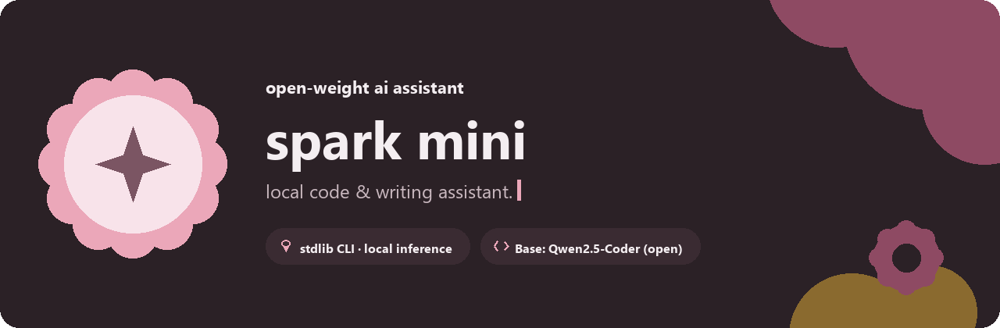
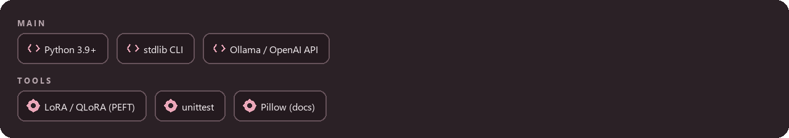
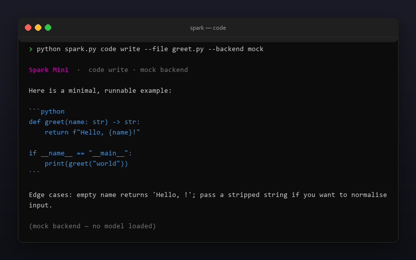
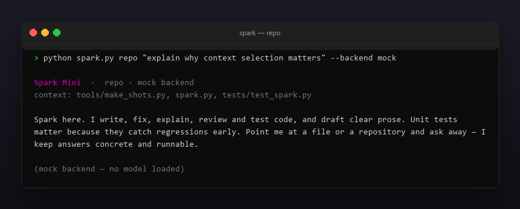
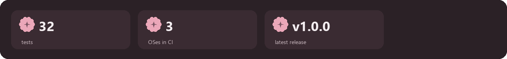

<p align="center"></p>

<p align="center">
  <a href="README.ru.md"></a>
  <a href="https://github.com/Celine1337/spark-mini/releases"></a>
  <a href="https://github.com/Celine1337/spark-mini/actions/workflows/ci.yml"></a>
  <a href="LICENSE"></a>
</p>


**Spark Mini** is a local code & writing assistant: a persona, a standard-library
CLI, retrieval over your repository, and an optional LoRA fine-tune recipe —
running on top of an **open-weight base model** (default
[Qwen2.5-Coder-1.5B-Instruct](https://huggingface.co/Qwen/Qwen2.5-Coder-1.5B-Instruct)).

What it is **not**: a from-scratch foundation model. No trained weights ship in
this repo, and nothing here claims to be "perfect". The intelligence comes from
the open base model you point it at; Spark Mini adds the persona, the prompts,
the repo context, the eval harness and the fine-tune tooling around it.

The CLI itself is standard-library only (Python 3.9+). It delegates inference to
a local [Ollama](https://ollama.com) or any OpenAI-compatible server (llama.cpp,
vLLM, LM Studio). A built-in `mock` backend produces deterministic placeholder
answers so demos, tests and CI run offline with **no model loaded** — every
screenshot below is labelled `mock` for that reason.


- Five modes: `ask`, interactive `chat`, `code` (write / fix / explain / review /
  test a single file), `repo` (question answered with retrieved repo context),
  and `write` (prose in plain / concise / friendly / formal tone).
- RAG-lite repository context: TF-IDF term scoring over source files, top-k
  snippets injected into the prompt — no embeddings, no vector DB, stdlib only.
- Three backends behind one interface: `ollama`, `openai` (compatible), `mock`.
  Switch with `--backend` or `SPARK_BACKEND`; point anywhere with `--base-url`.
- `--json` machine-readable output (persona, backend, model, response, context);
  `--temperature`, `--max-tokens`, `--timeout` knobs; `--no-color` / `NO_COLOR`.
- Optional GPU fine-tune pipeline in `finetune/`: prepare a chat dataset, train a
  LoRA / QLoRA adapter, merge it, and score it with a tiny offline eval harness.
- Honest failure modes: unreachable backend → exit `1` with a clear message;
  missing file / root → exit `2`. No silent fallbacks, no invented answers.


| Command | What it does |
|---------|--------------|
| `spark.py ask "…"` | one-shot question |
| `spark.py chat` | interactive session (`/exit` to quit) |
| `spark.py code <task> --file F` | write / fix / explain / review / test one file |
| `spark.py repo "…" --root DIR` | answer using top-k retrieved repo snippets |
| `spark.py write "…" --style S` | draft prose in the chosen tone |

Fine-tune pipeline (needs your own GPU; weights are **not** included):

| Step | Script | Notes |
|------|--------|-------|
| 1 | `finetune/prepare_data.py` | stdlib; `--jsonl` pairs or `--code DIR` self-supervised completion; dedupe + train/val split |
| 2 | `finetune/train_lora.py` | LoRA / QLoRA (PEFT) on the base model; guarded imports, exits `2` with an install hint if deps/GPU absent |
| 3 | `finetune/merge_lora.py` | merge adapter into base; convert to GGUF via llama.cpp for a light local runtime |
| 4 | `finetune/eval.py` | stdlib scoring: code answers must parse, prose must hit a keyword; `--backend mock` runs offline |





Offline, no model needed (this is what CI runs):

```console
$ python spark.py ask "hi" --backend mock
$ python spark.py code explain --file spark.py --backend mock
$ python spark.py repo "how does context selection work?" --backend mock
$ python finetune/eval.py --backend mock
```

With a real local model (Ollama):

```console
$ ollama pull qwen2.5-coder:1.5b
$ python spark.py code review --file app.py
$ python spark.py repo "where is auth handled?" --root .
$ python spark.py write "release notes for v1.1" --style concise
```

OpenAI-compatible server (llama.cpp / vLLM / LM Studio):

```console
$ python spark.py ask "explain this stack trace" --backend openai --base-url http://localhost:8080
```

Fine-tune on your GPU:

```console
$ pip install torch transformers peft datasets accelerate bitsandbytes
$ python finetune/prepare_data.py --code ./src
$ python finetune/train_lora.py --data data
$ python finetune/merge_lora.py --adapter spark-lora --out spark-merged
$ python finetune/eval.py --backend ollama --model spark-merged
```

Exit codes: `0` — success, `1` — backend unreachable / eval failed, `2` — bad
path, missing data, or missing GPU dependencies.


Both shots use the offline `mock` backend — placeholder answers, no model loaded.






```console
$ python -m unittest discover -s tests -v
```

32 tests cover the prompt builders, all three backends (including a local fake
HTTP server asserting request paths and payloads), the TF-IDF context selector,
CLI exit codes, the data preparer, the eval scorer, and graceful degradation of
the GPU scripts when dependencies are absent. Images are regenerable:

```console
$ pip install pillow
$ python tools/make_shots.py      # docs/code.png, docs/repo.png (mock backend)
$ python tools/make_style.py tools/style.json docs/style
```



[MIT](LICENSE) © Celine1337