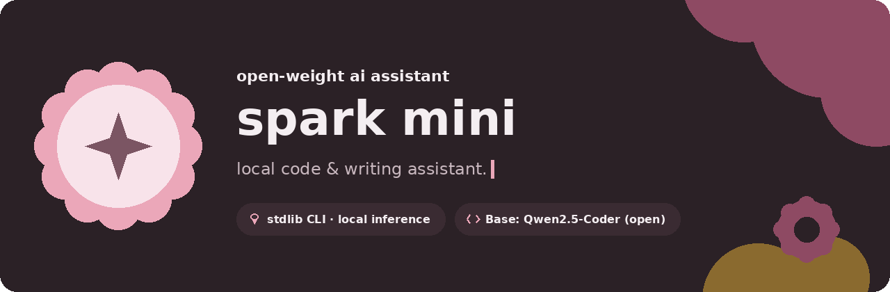
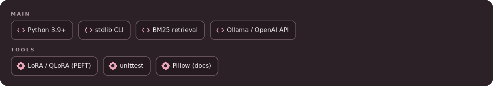
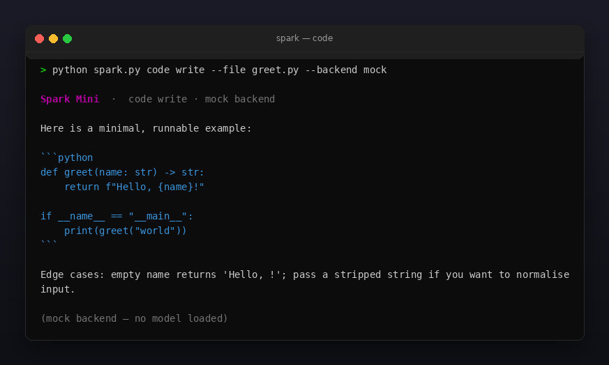
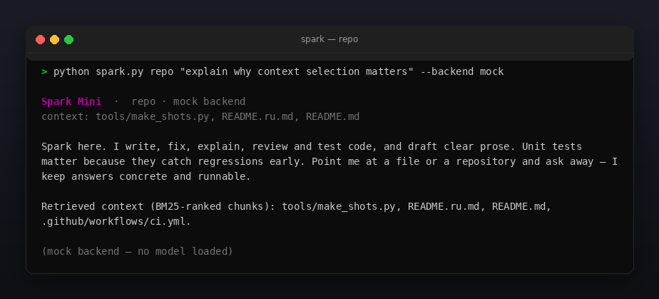
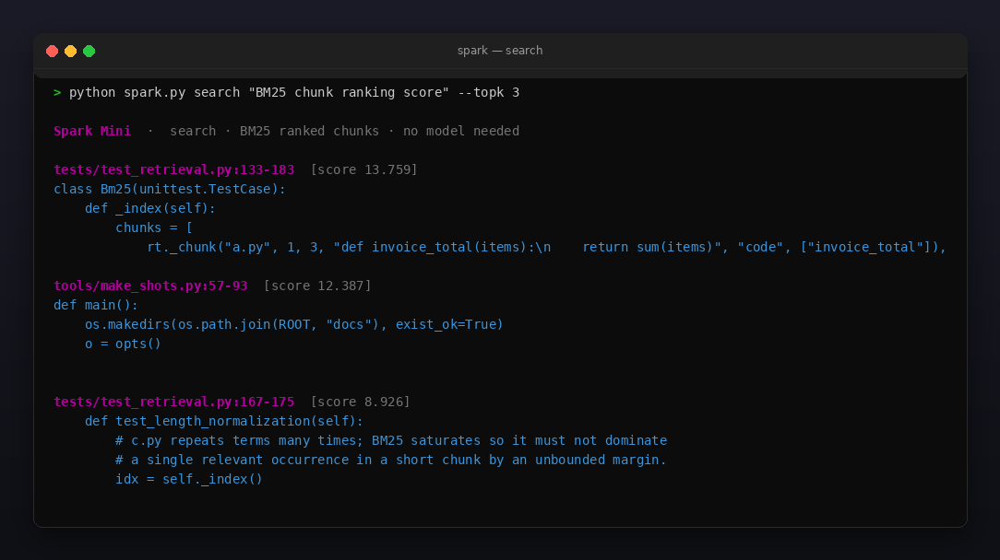

<p align="center"></p>

<p align="center">
  <a href="README.md"></a>
  <a href="https://github.com/Celine1337/spark-mini/releases"></a>
  <a href="https://github.com/Celine1337/spark-mini/actions/workflows/ci.yml"></a>
  <a href="LICENSE"></a>
</p>


**Spark Mini** — локальный ассистент для кода и текста: персона, CLI на
стандартной библиотеке, поиск контекста по вашему репозиторию и опциональный
рецепт LoRA-дообучения — поверх **открытой базовой модели** (по умолчанию
[Qwen2.5-Coder-1.5B-Instruct](https://huggingface.co/Qwen/Qwen2.5-Coder-1.5B-Instruct)).

Чем это **не** является: фундаментальной моделью, обученной с нуля. В репозитории
нет обученных весов, и никто не обещает «идеальную» модель. Интеллект даёт
открытая базовая модель, на которую вы указываете; Spark Mini добавляет персону,
промпты, контекст репозитория, eval-харнесс и инструментарий дообучения.

Сам CLI — только стандартная библиотека (Python 3.9+). Инференс делегируется
локальному [Ollama](https://ollama.com) или любому OpenAI-совместимому серверу
(llama.cpp, vLLM, LM Studio). Встроенный бэкенд `mock` выдаёт детерминированные
заглушки, поэтому демо, тесты и CI работают офлайн **без загруженной модели** —
все скриншоты ниже помечены `mock` именно поэтому.

**v1.1 делает сам инструментарий намного умнее.** Контекст репозитория — больше
не наивный TF-IDF по целому файлу плюс обрезанная «голова». Настоящий лексический
поисковый движок (`retrieval.py`) режет код по границам определений, а текст по
абзацам, токенизирует идентификаторы (`invoiceTotal` совпадает с `invoice_total`),
ранжирует чанки по **Okapi BM25** с бустом символов и имён файлов, инкрементально
кэширует индекс в `.spark/` и упаковывает в промпт **цитируемые, ограниченные по
токенам** выдержки (`path:start-end`). Рассуждает по-прежнему базовая модель —
просто теперь она видит *нужный* код, а не первые 1500 символов файла.


- Семь режимов: `ask`, интерактивный `chat`, `code` (write / fix / explain /
  review / test одного файла), `repo` (ответ с найденным контекстом репозитория),
  `write` (текст в тоне plain / concise / friendly / formal), плюс две
  поисковые команды без модели: `search` (ранжирование чанков) и `index`
  (построение / осмотр индекса).
- **Поисковый движок BM25** (`retrieval.py`, только stdlib): структурные чанки
  (код по границам `def`/`class`/`fn`/…, текст по абзацам) с 1-базовыми номерами
  строк; токенизация идентификаторов (подтокены camelCase / snake_case, удаление
  стоп-слов); Okapi BM25 (k1=1.5, b=0.75) с нормализацией по длине документа;
  буст символов и имён файлов; постоянный инкрементально инвалидируемый кэш
  `.spark/index.json` по mtime+size; упаковка контекста с бюджетом токенов и
  цитатами `path:start-end`. Без эмбеддингов и векторных БД.
- Три бэкенда за одним интерфейсом: `ollama`, `openai` (совместимый), `mock`.
  Переключение `--backend` или `SPARK_BACKEND`; адрес `--base-url`.
- Опциональный `--stream` потоковый вывод токенов для `ollama` / `openai`
  (NDJSON / SSE); `chat` получает `--root` (контекст репозитория), `/reset` и
  `/context`, и автоматическую обрезку памяти по бюджету токенов.
- `--json` машинный вывод (persona, backend, model, response, context;
  `search`/`index` отдают ранжированные результаты / статистику индекса);
  `--temperature`, `--max-tokens`, `--timeout`; `--no-color` / `NO_COLOR`.
- Опциональный GPU-пайплайн в `finetune/`: подготовка chat-датасета, обучение
  LoRA / QLoRA адаптера, слияние и оценка маленьким офлайн eval-харнессом.
- Честные ошибки: недоступный бэкенд → exit `1` с понятным сообщением; нет
  файла / каталога → exit `2`. Без тихих фолбэков и выдуманных ответов.


| Команда | Что делает |
|---------|------------|
| `spark.py ask "…"` | одиночный вопрос |
| `spark.py chat` | интерактивная сессия (`/exit`, `/reset`, `/context`; `--root` — контекст репо) |
| `spark.py code <task> --file F` | write / fix / explain / review / test одного файла |
| `spark.py repo "…" --root DIR` | ответ по top-k найденным цитируемым чанкам репозитория |
| `spark.py write "…" --style S` | текст в выбранном тоне |
| `spark.py search "…" --root DIR` | ранжирование чанков репо по BM25 (без модели) |
| `spark.py index --root DIR` | построение / осмотр индекса (`--rebuild` — принудительно) |

Пайплайн дообучения (нужен ваш GPU; веса **не** входят в репозиторий):

| Шаг | Скрипт | Примечания |
|-----|--------|------------|
| 1 | `finetune/prepare_data.py` | stdlib; `--jsonl` пары или `--code DIR` self-supervised продолжение; дедупликация + train/val |
| 2 | `finetune/train_lora.py` | LoRA / QLoRA (PEFT) на базовой модели; защищённые импорты, exit `2` с подсказкой установки без зависимостей/GPU |
| 3 | `finetune/merge_lora.py` | слияние адаптера с базой; конвертация в GGUF через llama.cpp для лёгкого локального рантайма |
| 4 | `finetune/eval.py` | stdlib-оценка: код должен парситься, текст — содержать ключевое слово; `--backend mock` офлайн |





Офлайн, без модели (это и гоняет CI):

```console
$ python spark.py ask "hi" --backend mock
$ python spark.py code explain --file spark.py --backend mock
$ python spark.py repo "how does context selection work?" --backend mock
$ python spark.py search "BM25 chunk ranking" --topk 3
$ python spark.py index
$ python finetune/eval.py --backend mock
```

С реальной локальной моделью (Ollama):

```console
$ ollama pull qwen2.5-coder:1.5b
$ python spark.py code review --file app.py
$ python spark.py repo "where is auth handled?" --root .
$ python spark.py write "release notes for v1.1" --style concise
$ python spark.py ask "explain this stack trace" --stream
```

OpenAI-совместимый сервер (llama.cpp / vLLM / LM Studio):

```console
$ python spark.py ask "explain this stack trace" --backend openai --base-url http://localhost:8080
```

Дообучение на вашем GPU:

```console
$ pip install torch transformers peft datasets accelerate bitsandbytes
$ python finetune/prepare_data.py --code ./src
$ python finetune/train_lora.py --data data
$ python finetune/merge_lora.py --adapter spark-lora --out spark-merged
$ python finetune/eval.py --backend ollama --model spark-merged
```

Коды выхода: `0` — успех, `1` — бэкенд недоступен / eval провален, `2` — плохой
путь, нет данных или нет GPU-зависимостей.


Скриншоты `code` и `repo` используют офлайн-бэкенд `mock` — заглушки, модель не
загружена. Скриншот `search` — чистый поиск (ранжирование BM25, вообще без модели).








```console
$ python -m unittest discover -s tests -v
```

100 тестов покрывают сборщики промптов, все три бэкенда (включая локальный
фейковый HTTP-сервер, проверяющий пути и тела запросов, плюс потоковые NDJSON/SSE),
поисковый движок BM25 (токенизация, чанки, буст символов/файлов, инвалидация кэша,
упаковка с бюджетом), команды `search`/`index`/`chat`, коды выхода CLI, подготовку
данных, eval-оценку и корректную деградацию GPU-скриптов без зависимостей.
Картинки воспроизводимы:

```console
$ pip install pillow
$ python tools/make_shots.py      # docs/code.png, docs/repo.png, docs/search.png
$ python tools/make_style.py tools/style.json docs/style
```


[MIT](LICENSE) © Celine1337